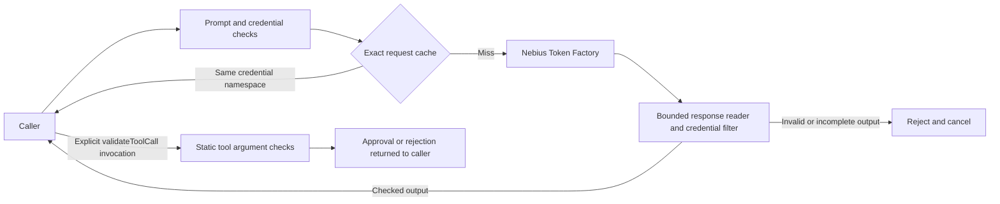

# 🛡️ NebiusGuard: Streaming Security Gateway for NVIDIA Models on Nebius Token Factory

> **Target Competition**: Nebius × NVIDIA Global AI Hackathon ($50,000+ Prize Pool on Devpost)  
> **Target Track**: Coding & Agentic Engineering / Apps & Agents  
> **Model selection**: discovers the live catalog and selects an available `nvidia/*` model
> **Endpoint**: Nebius Token Factory (`https://api.tokenfactory.nebius.com/v1`)
> **Status**: 29 passing tests and one real Token Factory stream verified October 28, 2026 using `nvidia/NVIDIA-Nemotron-3-Nano-30B-A3B`; [non-secret evidence](docs/live-verification-2026-10-28.md). This is a prototype, not a production-security guarantee.

[Watch the public narrated demo](https://youtu.be/SOOPTilt-HE) (2:44.465 source video; YouTube rounds to 2:45). The captured authenticated run and synthetic security cases are labeled separately. The [versioned release](https://github.com/sidsri14/nebiusguard/releases/tag/v0.2.0-hackathon) includes the original MP4, caption file and media-verification record.

---

## What it implements

`NebiusGuard` is a zero-dependency Node.js client and boundary-checking library for Nebius Token Factory. It inspects prompts, validates caller-supplied tool arguments, filters supported credential patterns from streamed output, bounds response reads, and records a hash-linked audit trail. These are tested controls with specific limits, not a production-security guarantee.

---

## 🏛️ Architecture & Core Components



### Static tool argument checks

- Checks tool names against a configured allowlist and accepts argument objects or JSON-encoded argument objects.
- Parses URL-bearing fields and URLs embedded in nested string arguments. WHATWG URL normalization handles case and integer/hexadecimal IPv4 spellings before host checks.
- Rejects localhost, the named cloud-metadata hostname, private RFC1918 IPv4 ranges, loopback/link-local/unspecified literals, private/link-local IPv6, and mapped private IPv4 addresses. Non-HTTP(S) destinations and URL-embedded credentials are rejected.
- Retains checks for path traversal and selected shell metacharacters.
- `validateToolCall` returns an approval/rejection; it does **not** execute tools or automatically inspect a model's tool calls. It does **not** resolve DNS or follow redirects. The caller's network executor must separately enforce resolved-address and redirect policies; a public-looking hostname can still resolve to a private address. Argument schemas and these pattern checks are not substitutes for sandboxing or safe APIs.

### Streaming output and bounded reads

- Reads JSON and SSE bodies incrementally, with a default 1 MiB byte limit. JSON overflow and an oversized declared content length cancel the response body instead of draining it first.
- Checks supported `sk-`, `AKIA`, `ghp_`, `nebius-`, and `v1.` credential patterns. To prevent a split credential prefix reaching `onChunk`, it retains the final 39 characters: the longest supported pattern's minimum match length minus one. Callback boundaries therefore differ from provider delta boundaries.
- Emits only checked text and flushes the withheld suffix only after SSE `[DONE]`. An unexpected EOF rejects, discards pending text, cancels/aborts the request, and does not store a successful cache entry. Earlier benign streamed output cannot be recalled.
- Pattern detection does not cover every secret format, encoding, or prompt-injection technique. Prompt inspection also uses a small, explicit pattern list.

### Exact inference cache and audit trail

- Uses an in-memory TTL `Map`, not an LRU or persistent cache; entry count is not currently bounded. No latency benchmark is claimed.
- Inference keys include prompt, model, temperature, token limit, and a SHA-256 hash of the exact effective API credential. A nonblank credential is required before either inference path can use a cached result. Credentials are not written into audit details. Cache hits do not revalidate upstream credential revocation or account permissions.
- Audit events are hash-linked and can be checked with `guard.verifyAuditChain()`. The in-memory log is not a durable, independently anchored or authenticated audit service.

---

## 🚀 Quickstart and verification

```bash
# Run unit and integration-style tests with an injected HTTP transport
npm test

# Run the deterministic offline boundary demonstration
npm run demo
```

The offline demo never claims a provider call. It is useful for reviewing prompt, tool, stream, cache, circuit-breaker, and audit behavior without credentials.

### Live Token Factory proof

Create a Token Factory API key in the official console, keep it out of chat and Git, and export it only in your shell:

```bash
export NEBIUS_API_KEY="..."
# Optional: copy an exact NVIDIA model ID from your live catalog.
export NEBIUS_MODEL="nvidia/NVIDIA-Nemotron-3-Nano-30B-A3B"
npm run demo:live
```

Alternatively, put `NEBIUS_API_KEY=...` in a private `.env.local` beside `package.json` and run `npm run demo:live`. The live demo loads that file with Node's built-in `process.loadEnvFile` when available; existing exported environment values retain precedence. Both `.env` and `.env.local` are gitignored. If the installed Node runtime lacks `process.loadEnvFile`, use the shell-export route or a current Node 20/22/24 runtime. Never commit the file or paste its contents into chat.

PowerShell:

```powershell
$env:NEBIUS_API_KEY = "..."
# Optional: $env:NEBIUS_MODEL = "exact nvidia/* model ID from the catalog"
npm run demo:live
```

`demo:live` first calls `/models`, refuses a requested model that is absent from the account's catalog, then streams one bounded completion through the real gateway. The output records the selected model, provider path, audit-event count, and audit-chain verification without printing the key.

### Evidence boundary

- Offline tests cover request construction, bearer headers, literal URL normalization, supported credential patterns across splits, cancellation during oversized reads, incomplete-stream rejection, credential-scoped caching, and audit-chain verification using injected transports.
- A passing test is not evidence that this checkout made a real paid/provider request.
- The October 28 [captured run](docs/live-verification-2026-10-28.md) separately verifies one authenticated catalog request and streamed completion. Model access can differ by account; `demo:live` discovers the current catalog instead of relying on the library's example default.
